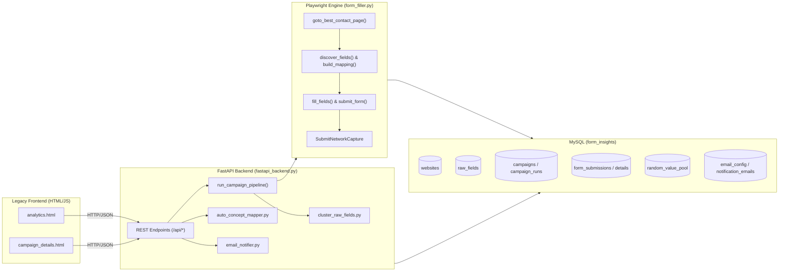

# Contact Form Filler — Complete Project Analysis

## 1. Project Overview
**Contact Form Filler** is a full-stack web automation platform designed to discover contact pages on target websites, extract and semantically classify HTML form fields, manage outreach campaigns, and automate form filling and submission using Playwright, backed by a FastAPI server and a MySQL (`form_insights`) database.

### Main Objective
Provide an end-to-end automated outreach and form-discovery pipeline that:
1. Stores and tracks target website URLs, scan metadata, and discovered form fields.
2. Normalizes and clusters raw HTML form inputs into canonical concepts (e.g., `full_name`, `email`, `phone`, `company`, `subject`, `message`, `consent`, etc.).
3. Organizes target websites into campaigns with configurable field-value strategies (constant sender values or random-value pools).
4. Executes two-phase Playwright automation (Phase 1: Discovery/Scraping; Phase 2: Filling/Submission) while detecting CAPTCHAs and capturing HTTP POST responses.
5. Sends email notifications for successful submissions and surfaces analytics in a web dashboard.

---

## 2. Existing Features
- **Website & Form Discovery**:
  - Multi-strategy contact page discovery (`goto_best_contact_page` in `backend/form_filler.py`, `advanced_scraper_mysql.py`).
  - Overlay/cookie-banner dismissal (`dismiss_overlays`).
  - Field discovery across main document and `<iframe>` elements (`discover_fields`, `discover_fields_from_root`).
  - CAPTCHA & anti-bot detection (`detect_captcha_on_page` for reCAPTCHA, hCaptcha, Cloudflare Turnstile, challenge pages).
- **Field Normalization & Concept Mapping**:
  - Heuristic scoring (`score_field_for_cluster`, `build_mapping` in `form_filler.py`).
  - Offline/batch clustering (`cluster_raw_fields.py` v2 scoring, `field_clustering.py`, `auto_concept_mapper.py`).
  - Random value pool (`random_value_pool` table, CSV import/sample/count endpoints).
- **Campaign Management**:
  - Campaign creation (`POST /api/campaigns`) with target URLs and per-concept strategies (`constant` vs `random`).
  - Asynchronous campaign execution (`POST /api/campaigns/{id}/start`, `pause`, `restart`, `status`).
  - Legacy ad-hoc form filling (`POST /api/fill-all-forms`, `GET /api/fill-status/{job_id}`).
- **Submission Auditing & Notifications**:
  - Records `form_submissions` and `form_submissions_details` (request URL, payload JSON, response JSON, status code).
  - SMTP email notifications (`backend/email_notifier.py`, `/api/notification-emails`, `/api/email-config`, `/api/test-email`).
- **Legacy Frontend**:
  - `frontend/analytics.html` (2,675-line monolithic HTML/JS/CSS file) for dashboard stats, campaign creation, random value CSV import, and email settings.
  - `frontend/campaign_details.html` (343 lines) for polling campaign run status.
  - `frontend/index.html` (275 lines, obsolete/disconnected from current API).

---

## 3. Complete Application Workflow

1. **URL Ingestion**:
   - URLs enter either directly in the `websites` table (via import scripts like `import_urls.py`, `add_urls.py`, or `ensure_websites_exist()` during `POST /api/campaigns`).
2. **Website Scraping & Contact Page Discovery**:
   - `form_filler.py` (`scrapeallforms` -> `run_batch(..., mode="scrape")`) launches headless Chromium via Playwright.
   - `goto_best_contact_page()` scores anchor links (`score_contact_link`) on the homepage and navigates to the highest-scoring contact/enquiry page, or falls back to common paths (`/contact`, `/contact-us`, etc.).
3. **CAPTCHA Detection**:
   - `detect_captcha_on_page()` checks for reCAPTCHA, hCaptcha, Turnstile iframes/scripts/divs, or Cloudflare challenge titles/body text. If found, marks status `captcha` and aborts filling.
4. **Form Field Detection**:
   - `discover_fields()` collects `input`, `textarea`, `select` elements across the page and iframes, extracting `tag`, `type`, `name`, `id`, `placeholder`, `aria-label`, `label_text`, and visibility into `FieldMeta`.
5. **Field Classification & Clustering**:
   - During live filling, `build_mapping()` scores each `FieldMeta` against `CLUSTERS` (checking `type`, `tag`, and keyword matches in `blob_field`) and greedily assigns each concept to the best-scoring unused selector (`score >= 6`).
   - Separately, `cluster_raw_fields.py` and `auto_concept_mapper.py` normalize `raw_fields` rows into `cluster_key` and `field_concept_map` (`CANONICAL_CONCEPTS`).
6. **Value Selection**:
   - Currently in `process_website_inner()`, `RandomValuePool.values_for_concepts()` queries `random_value_pool` by `field_concept` (with a `concept_map` alias dictionary) and falls back to hardcoded defaults (`'Contact User'`, `'contact@example.com'`, etc.).
   - *Gap*: `fastapi_backend.py` builds `base_userdata` from `campaigns` (`sender_name`, `sender_email`, `subject_line`, `message_body`), but `form_filler.py` does not currently consume `userdata` field overrides or `campaign_field_strategy` rows.
7. **Form Filling & Submission**:
   - `fill_fields()` scrolls to each mapped element, clicks, and calls `.fill()`, `.select_option()`, or `.check()` (for `consent`).
   - `SubmitNetworkCapture` attaches `request` and `response` listeners on the Playwright `Page` before `submit_form()` clicks the submit button.
   - After `POST_SUBMIT_WAIT_MS` (default 8000ms), `capture.best_submission()` and `wait_for_submit_post_response()` evaluate captured POST requests/responses.
8. **Response Interpretation & Recording**:
   - `interpret_submission_response()` inspects JSON responses for `success` booleans or keywords (`captcha`, `error`, `success`, `sent`, `thank`).
   - `success_text_on_page()` checks page body text against `SUCCESS_TEXT_RE`.
   - `MySQLDB.save_submission()` and `save_details()` persist results to `form_submissions` and `form_submissions_details`.
9. **Email Notifications**:
   - On `status == "success"`, `EmailNotifier.send_notification()` loads SMTP settings from `email_config` and active recipients from `notification_emails` and sends an HTML summary email.
10. **Campaign Execution & Progress**:
    - `POST /api/campaigns/{id}/start` creates a `campaign_runs` row and spawns an `asyncio` task running `run_campaign_pipeline()`.
    - The frontend polls `GET /api/campaigns/{id}/status` every 1.2s.

---

## 4. Architecture Diagram

---

## 5. Frontend Architecture
- **Active UI**: `frontend/analytics.html` (2,675 lines) + `frontend/campaign_details.html` (343 lines).
- **Obsolete UI**: `frontend/index.html` (calls non-existent `/api/stats`, `/api/urls`), root `analytics1.html`, `analytics2.html`, `analytics3.html`.
- **Technology**: Vanilla HTML, inline CSS, and inline JavaScript using `fetch()` with hardcoded `APIBASE = "http://127.0.0.1:8000/api"`.
- **State & Rendering**: Imperative DOM manipulation (`innerHTML`), `setInterval` polling every 1.2s, no component reuse, no router, no TypeScript, no build pipeline.

---

## 6. Backend Architecture
- **Entry Points**: `backend/run_server_windows.py` (sets `WindowsProactorEventLoopPolicy` and runs `uvicorn fastapi_backend:app`), `backend/run_server.py`.
- **Core API**: `backend/fastapi_backend.py` (1,389 lines) — monolithic file containing DB config, DDL, Pydantic models, all REST routes, background task management, and duplicated pipeline functions.
- **Automation**: `backend/form_filler.py` (2,066 lines) — contains Playwright automation, `MySQLDB` adapter, `RandomValuePool`, `FieldMeta` scoring, and `SubmitNetworkCapture`.
- **Auxiliary / Legacy Scripts**: 50+ one-off diagnostic, migration, and backup scripts in `backend/` (`fastapi_backend_broken.py.bak`, `debug_campaign_*.py`, `fix_*.py`, `check_*.py`).

---

## 7. Database Structure (`form_insights` MySQL / MariaDB)
Key active tables observed in `form_insights (2).sql`:
- `websites`: `id`, `url`, `timestamp`, `form_found`, `has_captcha`, `is_dead`
- `raw_fields`: `id`, `website_id`, `tag_name`, `field_id`, `field_name`, `field_type`, `placeholder`, `class_name`, `form_id`, `form_class`, `cluster_key`, `cluster_score`, `cluster_version`, `clustered_at`
- `field_concept_map`: `id`, `normalized_label`, `canonical_concept`, `is_manual`, `last_updated`
- `field_mapping`: `id`, `raw_name`, `normalized_name`
- `random_value_pool`: `id`, `field_concept`, `value`, `created_at`
- `campaigns`: `id`, `name`, `description`, `sender_name`, `sender_email`, `subject_line`, `message_body`, `max_websites`, `status`, `results_success`, `results_failed`, `results_captcha`, `created_at`, `updated_at`
- `campaign_websites`: `id`, `campaign_id`, `website_id`, `website_url`
- `campaign_field_strategy`: `id`, `campaign_id`, `field_concept`, `strategy`, `constant_value`, `created_at`
- `campaign_runs`: `id`, `campaign_id`, `status`, `progress`, `total`, `results` (JSON), `error`, `started_at`, `finished_at`, `created_at`
- `form_submissions`: `id`, `website_id`, `url`, `normalized_url`, `status`, `filled_fields`, `error`, `created_at`, `campaignid`
- `form_submissions_details`: `id`, `submission_id`, `request_url`, `payload_json`, `response_json`, `status_code`, `created_at`
- `email_config` & `notification_emails`: SMTP settings and recipient list.
- Legacy/duplicate tables present in SQL dump: `formsubmissions`, `formsubmissionsdetails`, `form_fields`, `field_values`. Also SQLite files exist in `data/` (`analytics.db`, `forms_insights.db`, `urls.db`) and `backend/` (`formfiller.db`, `forms_insights.db`, `form_filler.db`).

---

## 8. API Endpoint Documentation (Current `fastapi_backend.py`)
| Method | Path | Purpose |
|---|---|---|
| `GET` | `/api/websites` | Aggregate counts (`total`, `visited`, `formstotal`, `captchatotal`, `deadsites`, `zerofieldsites`) |
| `GET` | `/api/websites-with-fields` | Paginated websites joined with `raw_fields` |
| `GET` | `/api/field-frequency` | Raw field name frequency distribution |
| `GET` | `/api/field-mapping` | Cluster key counts from `raw_fields` |
| `GET` | `/api/form-submissions` | Paginated `form_submissions` joined with `form_submissions_details` |
| `GET` | `/api/dead-sites` | Paginated websites with `form_found=0` and `has_captcha=0` |
| `GET` | `/api/zero-field-sites` | Paginated visited websites with 0 `raw_fields` |
| `GET` | `/api/fill-form-template` | Concepts grouped by prevalence (currently broken key lookup) |
| `GET` | `/api/concepts-debug` | Debug sample of `get_concept_details()` |
| `POST` | `/api/random-values/import-csv` | Replace `random_value_pool` entries for a `fieldconcept` from CSV |
| `GET` | `/api/random-values/{fieldconcept}/sample` | Random sample of pool values |
| `GET` | `/api/random-values/{fieldconcept}/count` | Count of pool values for a concept |
| `POST` | `/api/campaigns` | Create a draft campaign with websites and field strategies |
| `GET` | `/api/campaigns` | List all campaigns with target count |
| `GET` | `/api/campaigns/{campaign_id}` | Get campaign details, websites, strategies, and `lastRun` |
| `GET` | `/api/campaigns/{campaign_id}/status` | Get latest run status/progress/results |
| `POST` | `/api/campaigns/{campaign_id}/start` | Start a new `campaign_runs` background task |
| `POST` | `/api/campaigns/{campaign_id}/restart` | Alias for `start` |
| `POST` | `/api/campaigns/{campaign_id}/pause` | Sets `campaigns.status = 'paused'` |
| `POST` | `/api/fill-all-forms` | Legacy ad-hoc form fill job |
| `GET` | `/api/fill-status/{job_id}` / `/api/fill-status` | Poll legacy job status |
| `GET/POST` | `/api/notification-emails` | List / add notification recipients |
| `DELETE/PATCH` | `/api/notification-emails/{email_id}` | Delete / toggle active recipient |
| `GET/POST` | `/api/email-config` | Get (masked) / update SMTP configuration |
| `POST` | `/api/test-email` | Send test notification email (currently broken import) |

---

## 9. Dependencies (`backend/requirements.txt`)
Currently listed:
- `playwright==1.40.0`, `beautifulsoup4==4.12.0`, `fastapi==0.104.0`, `uvicorn==0.24.0`, `pydantic==2.5.0`, `aiofiles==23.2.0`, `httpx==0.25.0`, `aiohttp==3.9.0`, `python-multipart==0.0.6`.
**Missing from `requirements.txt` but required by code**:
- `mysql-connector-python`
- `python-dotenv` (for `.env` configuration)

---

## 10. Current Execution Instructions
1. Ensure MySQL/MariaDB is running on `127.0.0.1:3306` with database `form_insights` imported from `form_insights (2).sql` (or via XAMPP `start_mysql.py`).
2. Install Python dependencies and Playwright Chromium: `pip install -r backend/requirements.txt && playwright install chromium`.
3. Start backend from `backend/`: `python run_server_windows.py` (Windows) or `python run_server.py`.
4. Open `frontend/analytics.html` via a local static server (e.g. port 5500) or browser.

---

## 11. Summary of Identified Problems & Recommended Improvements
See `PROJECT_ISSUES.md` for the complete categorized breakdown. Key priorities:
1. **Fix critical backend bugs**: Remove duplicate `run_campaign_pipeline`, fix `MySQLDB` import in `/api/test-email`, fix `field_prevalence` key mismatch, add `/health` endpoint, enforce single active run per campaign, support true pause/resume/cancel, and pass campaign field values/strategies to `form_filler.py`.
2. **Enforce responsible automation**: Do not mark unknown POST responses as `"success"` (`best-effort success`); require explicit evidence of success; block internal/SSRF URLs.
3. **Refactor backend**: Split `fastapi_backend.py` into clean `app/` modules (`api/routes`, `core`, `services`, `database`, `schemas`), centralize env config, and add structured logging.
4. **Redesign frontend**: Replace `analytics.html` and `campaign_details.html` with a modern React + TypeScript + Vite + Tailwind + shadcn/ui + Recharts SaaS application with all 11 required pages.
